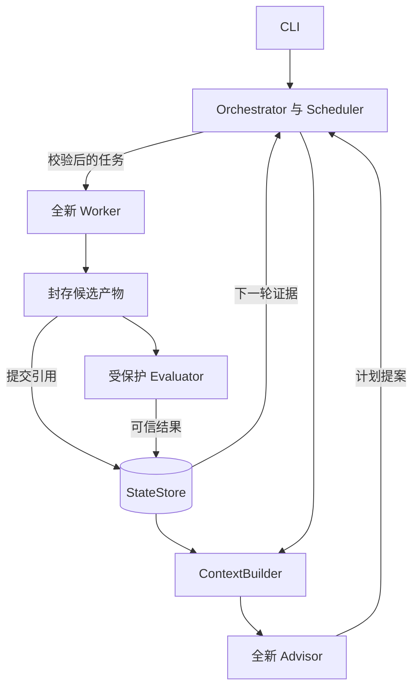

# mini SLA harness 总体架构与接口设计

[返回设计总览](00-overview.md)

系统以持久研究状态驱动实验。一个本地控制器负责调度、事务和预算；Advisor 只提计划，Worker 只在独立 Trial 中修改允许的代码，正式成绩由受保护评估器产生。本文固定组件职责、上下文边界和内部协议，使产品需求能够拆分为可实现模块。

## 1 架构决策与运行边界

SLA 指 Stateless Language Agents。系统采用无状态调用、角色专属上下文、局部分支与全局最优、独立评估和单机 CLI；研究背景见 [Stateless Language Agents 论文](https://arxiv.org/abs/2610.07625)。

| 决策 | 本版约定 | 原因与后续边界 |
| --- | --- | --- |
| ADR 01 部署 | Linux 单机；一个控制器；本地 SQLite WAL | 先验证可靠闭环；多机、高可用与队列留到后续 |
| ADR 02 入口 | CLI 与进程内类型化命令 | 无需 HTTP 服务即可运行；后续 UI 调用同一应用层 |
| ADR 03 执行 | Python asyncio 调度，沙箱子进程执行 | 模型调用与评估均不占数据库写事务 |
| ADR 04 候选 | 内容寻址快照为权威；Git 可选用于 diff | 哈希对应真实可恢复代码；Git worktree 本身不提供隔离 |
| ADR 05 评估 | 正式性能评估串行；编程 Worker 可并行 | 避免多个 benchmark 互相争抢 CPU 影响排名 |
| ADR 06 范围 | 一个 TaskAdapter 与一个真实模型适配器先交付 | 小探针验证真实集成，FakeAgent 验证协议故障；多供应商留在接口层 |
| ADR 07 统计 | 固定评估指纹与整数 bps 提升阈值 | 先按 T-30 校准噪声与敏感度，再冻结阈值与采样参数 |

默认规模是 1 个 Advisor、最多 3 个并行 Worker 槽位、每 Assignment 最多 3 次逻辑 Trial。它们都是可配置上限；一个 Trial 内可包含多次模型调用与公开测试，不能将 Trial 数当作模型调用数。MVP 不使用 Redis、向量数据库、微服务、Kubernetes 或 Worker 直接互发消息。



图 1 受控提案与确定性状态流。只有应用层 StateStore 可以写入权威数据库。

## 2 模块职责与接口边界

| 模块 | 核心接口 | 输入与产出 |
| --- | --- | --- |
| TaskAdapter | validate_task / build_public_view / grade | 公开任务与评估私有配置分开；生成固定 task_spec_hash 与 evaluation_spec_hash |
| StateStore | execute(command) / snapshot(scope) | 校验主体、状态、代次、版本及幂等；返回已提交结果 |
| ContextBuilder | for_advisor / for_worker | 一致性快照转换为定长角色上下文，记录 context_hash |
| AdvisorScheduler | validate_plan / commit_plan | 验证结构化任务提案；原子生成 Assignment 和 Branch |
| WorkerRuntime | start_fresh / run_tools / freeze | 创建临时会话与沙箱；返回候选引用和非权威实验说明 |
| ModelGateway | reserve / invoke / reconcile | 主机侧调用模型；逐次用量可追溯；Worker 不接触提供商密钥 |
| Evaluator | claim / execute / record | 对封存候选进行正确性与性能测量；独立租约与 attempt |
| ArtifactStore | seal / verify / materialize | 不可变对象、清单与哈希；提供受控恢复工作区 |
| Orchestrator | tick / pause / recover / stop | 驱动 Epoch 屏障、重试、取消、回收与预算准入 |

控制器启动时持有操作系统文件锁；第二个控制器直接拒绝启动。CLI 运行期的控制命令通过权限为 0600 的本地 Unix socket 请求现有控制器，不能自行打开第二个写入者。Worker 与候选程序不获得此 socket。控制器持有唯一写连接；只读查询使用短读取事务。SQLite WAL 可使读写并行，但同时只能有一个写事务，数据库必须位于同机本地磁盘。[SQLite WAL](https://sqlite.org/wal.html)

StateStore 的事务代码必须同步、短小，BEGIN IMMEDIATE 后不得 await 模型调用、容器操作、文件上传或 benchmark。繁重操作在事务外完成，随后凭不可变引用提交。SQLite 的写入争用与 SQLITE_BUSY 需要有界重试。[SQLite 事务](https://sqlite.org/lang_transaction.html)

## 3 一轮研究的完整执行流程

- 初始化：CreateRun 原子注册 starter Candidate、baseline_evaluation_id 与唯一 BASELINE job，Run=CREATED。StartRun 幂等驱动该 job；有效结果由 InitializeBaseline 原子设置初始 Best，只有未暂停／停止才进入 RUNNING。CREATED 崩溃恢复继续同一 job，不重新注册基线；失败或重试耗尽明确 FAILED。

- 规划：OpenEpoch 原子建立 PLANNING Epoch 和唯一逻辑 advisor_invocation，绑定一致性快照、上下文字节／哈希、模板、模型配置及证据 event_seq。物理 attempt 和 call_id 分开记录；最多一次格式修复，所有重试／修复共享该 invocation 的累计预算。先持久发送意图，再请求模型。

- 落地计划：先由 RecordAdvisorResponse 持久化原始响应、plan artifact/hash，置 PLAN_RECEIVED，再由 CommitPlan 在同一事务校验 Run=RUNNING、Epoch=PLANNING、invocation 当前且未取消、snapshot_version、同 Run 引用、槽位、路径和配额；原子生成整个计划、Assignment／Branch，置 invocation=COMMITTED、Epoch=READY。重复提交不重复创建；暂停保留计划不提交，恢复先复核快照；过期计划明确失效并在原逻辑预算内有界重新规划。

- 执行：每个 Assignment 惰性创建下一个 Trial；创建时固定 base = Branch.head 或 Branch.base。同分支不得已有 PENDING 或执行中的 Trial。领取成功后启动新会话，公开工具只作用于该沙箱。

- 接受候选：可信父进程冻结并验证文件清单，先持久化对象再提交候选；事务检验 Worker fence 与 lease，写 Candidate、Evaluation job 和事件，清除 Worker 执行权。

- 评估与结算：Evaluator 用独立执行代次；可信 supervisor 计时并核对输出。RecordEvaluation 只持久化不可变 DONE 事实；FinalizeTrial 才原子更新 Head／Best、Trial 终态、事件和 receipt，必须检查 stop_mode!=FORCE。force 与 finalize 以同一数据库写事务提交顺序决定胜负；先 finalize 则保留，先 force 则该 Trial CANCELLED，已有 DONE 结果只作证据。

- 继续与屏障：Assignment 未用完 max_trials 且 Run 允许新工作时，启动下一 Trial。仅当所有 Assignment 明确终结，Epoch 才能关闭；不能只看当前已创建的 Trial 是否结束。

- 下一轮：销毁已完成会话和临时工作区，从持久状态重新构建 Advisor 上下文。Run 到预算、轮次或人工停止条件时，保存成果与停止原因。

PAUSING 禁止新 Trial、领取 PENDING 和新 Advisor 请求；已开始 Trial 可在累计预算／超时内排空。已发送 Advisor 响应可落 PLAN_RECEIVED，不新发修复、不 CommitPlan；响应无用量时保留 UNKNOWN。暂停屏障同时检查 baseline、Trial、Evaluator 和 Advisor，无活跃执行后保存 resume_phase，进入 PAUSED。STOPPING（DRAIN）取消 PENDING 与规划、排空已开始 Trial／baseline；无 Assignment 的 Epoch 也须 CLOSED 或明确取消。force 原子取消所有非终态研究对象并设置 durable stop_mode=FORCE，随后终止进程；不撤销已提交晋升，但阻断所有未 finalize 结果。 baseline 首次 claim 提交即算开始：pause 前未领取则保留并以 INITIALIZING 恢复，DRAIN stop 前未领取则取消；已开始 job 可有界排空。resume_phase 固定为 INITIALIZING／READY_TO_RUN／PLANNING／EXECUTING。

## 4 上下文与证据访问设计

| 角色 | 默认可见 | 默认不可见 |
| --- | --- | --- |
| Advisor | 公开任务契约；全局最佳摘要；按方向聚合的正式结果；失败分类；预算与假设标签 | 受保护测试源码、数据集；模型凭证；完整 Worker 对话与推理 |
| Worker | 本 Assignment；固定 base 代码；该分支最近正式反馈；公开说明及公开测试 | 其他分支私有日志和工作区；数据库；受保护测试；旧会话缓存 |
| Evaluator | 精确候选快照；私有评分配置；测试输入和参考结果 | 模型凭证；控制器写接口；其他 Trial 的可写工作区 |

上下文构造从一个短读取事务获得完整快照，立即退出事务，再格式化文本。同一 snapshot_id、相同可见内容、模板版本和 tokenizer 版本必须生成相同字节与哈希。固定排序使用 branch_id 和 trial_no；运行时钟、随机 UUID 不进入稳定前缀。prompt cache 仅是成本优化，缓存未命中不能影响正确性。

建议 Advisor 初始上下文上限 8K token，Worker 初始上下文上限 12K token，且不超过适配器模型上下文容量。保留顺序为任务契约、固定候选标识与局部反馈、方向证据摘要；长日志只保留诊断码及引用。截断必须保留事实来源 ID，并写 truncated_fields。每次工具返回后的完整输入重新计量，不能只限制首条 prompt。

Worker 的 read_evidence 接口必须校验 run、branch 和 evidence_type；禁止访问其他分支证据，即使 Worker 猜中了 ID。事实标记 OBSERVED，假设标记 HYPOTHESIS，调度结论标记 DECISION。Agent 写出的“方向已耗尽”只能作为假设，不能直接改变分支状态。 ContextBuilder 与 GetEvidence 均采用显式 purpose 白名单 BASELINE/SEARCH，拒绝 FINAL_AUDIT 的输入、结果和诊断引用；仅在人类导出报告中展示审计，不能只靠提示词要求模型忽略。

```text
EvidenceRef = {
  "kind": "OBSERVED",
  "evaluation_id": "eval_004",
  "candidate_id": "cand_004",
  "verdict": "VALID_SCORED",
  "score_i": 96000000
}
```

独立复现实验需明确 independent_replication=true 与原因，并占用预算。基础去重键由 direction_key、base_candidate_id、规范化 editable_files 和 hypothesis_key 组成；它只能发现结构性重复，不能承诺识别语义等价实验。重复代码哈希单独统计，不默认复用带噪声 benchmark 的旧成绩。

## 5 内部协议与契约示例

MVP 的 API 是进程内命令与只读查询。通用命令信封包含 schema_version、command_id、type、run_id、payload；身份从本地可信通道绑定，不能信任请求自行声明的 role。request_hash 对 type、run_id 与规范化 payload 计算 SHA-256。command_id 相同且内容不同必须报 IDEMPOTENCY_CONFLICT。

```text
{
  "schema_version": 1,
  "command_id": "cmd_submit_017",
  "type": "SubmitCandidate",
  "run_id": "run_001",
  "payload": {
    "trial_id": "trial_017",
    "claim_generation": 2,
    "artifact_hash": "<64 lowercase hex>",
    "report": {"hypothesis": "减少临时对象",
               "experiment_summary": "候选已生成，等待正式评估"}
  }
}
```

artifact_hash 由可信父进程重新计算并校验；请求中的哈希仅用于比对。Worker 不提交权威分数或自报费用。SubmitCandidate 的成功响应返回 candidate_id、evaluation_id、trial_state=CANDIDATE_READY；重复成功命令返回原响应并设置 replayed=true。

| 命令或查询 | 调用方 | 必要检查 |
| --- | --- | --- |
| CreateRun / StartRun / InitializeBaseline | 操作用户与控制器 | 原子绑定唯一 baseline job；CREATED 可恢复；初始化提交服从暂停／停止模式 |
| OpenEpoch / ClaimAdvisor / RecordAdvisorResponse / CommitPlan | 控制器与 ModelGateway | invocation／attempt／快照有效；响应先落盘；计划幂等整体提交；暂停不提交 |
| CreateTrial / ClaimTrial | 调度器与 Runtime | 分支无活跃 Trial；预算准入；冻结 base；递增代次 |
| Heartbeat / SubmitCandidate | 可信 Runtime | trial + owner + generation + lease；路径与产物合法 |
| ClaimEvaluation / RecordEvaluation | 评估服务 | 独立 eval_generation 与 attempt；结果来源、指纹与哈希 |
| FinalizeTrial | 控制器 | 候选与正式评估匹配；业务唯一；同一 Run；仅 SEARCH；允许 DRAIN、禁止 FORCE |
| Pause / Resume / Stop | 操作用户 | 当前状态合法；重复请求幂等；force 显式撤销 |
| GetRun / ListTrials / GetEvidence | 授权只读方 | 作用域过滤；cursor 分页；日志脱敏 |
| FreezeFinal / AuditFinal / Export / Checkpoint / Verify | 操作用户与控制器 | final 候选与清单冻结；审计独立身份且无晋升权；导出标明审计结果、不导出私有测试 |

AssignmentSpec 字段为 assignment_id、epoch_id、worker_slot、branch_action（NEW 或 CONTINUE）、branch_id（继续时必填）、direction_key、hypothesis_key、hypothesis、objective、editable_files、max_trials、independent_replication。NEW 的起点由 Harness 在提交计划时从全局最佳确定；Advisor 不能任意指定跨 Run Candidate。

WorkerReport 只含 experiment_summary、hypothesis、public_checks、artifact_ref。EvaluationResult 含 evaluation_id、purpose（BASELINE／SEARCH／FINAL_AUDIT）、eval_generation、candidate_id、artifact_hash、evaluation_spec_hash、verdict、score_i、samples、diagnostic_code 和受控日志引用。每个 sample 含 input_manifest_entry_id、record_count、input_bytes、elapsed_ns、process_instance_id、output_hash。FINAL_AUDIT 的 spec 使用独立 audit_spec_hash，仅写 audit_record；不可进入 Trial 晋升接口。分数仅由可信 supervisor 计算；候选 stdout 只接受限长、非执行式数据编码，禁用 pickle／eval 反序列化。

| 错误码 | 含义 | 调用方处理 |
| --- | --- | --- |
| INVALID_COMMAND / PLAN_INVALID | 字段或计划违反契约 | 修复内容后使用新 command_id |
| IDEMPOTENCY_CONFLICT | 同 key 的请求内容不同 | 停止自动重试，修复调用方 |
| STALE_CLAIM / LEASE_EXPIRED | 执行权已失效 | 停止提交；后端核对实际费用 |
| STATE_CONFLICT / STALE_SNAPSHOT | 当前状态不允许变更 | 重新读取状态，不盲目覆盖 |
| BUDGET_EXHAUSTED / SCOPE_BUDGET_EXHAUSTED / USAGE_UNCERTAIN | 预算不足或未决用量阻塞 | 停止新调用；对账或等待 |
| ARTIFACT_INVALID / EVALUATION_MISMATCH | 快照、父候选或评估指纹不符 | 保留诊断，禁止晋升 |
| RETRYABLE_INFRA_ERROR | 有界可恢复的基础设施问题 | 新物理 attempt；保持逻辑对象身份 |

```text
{"ok": false, "command_id": "cmd_submit_017",
 "error": {"code": "STALE_CLAIM", "retryable": false,
           "message": "当前 Trial 已由新的执行代次接管"},
 "state_revision": 48}
```

## 6 执行隔离与评分可信边界

主机侧 Agent Runner 调用模型，工具在非特权容器执行。容器只挂载公开任务与本 Trial 工作区，根文件系统只读，临时目录有大小限制，禁网、drop capabilities、no-new-privileges、限制 CPU、内存、进程数和 wall-clock。不给候选挂载 Docker socket、StateStore、本地控制 socket、主机 HOME 或模型 API 密钥。环境探针须实际尝试越权读取、联网、超额资源和停止子进程树，并记录拒绝结果；升级镜像或隔离配置后复跑。[S5]

允许读的源码与允许改的源码分开描述。冻结时遍历规范化路径，拒绝路径穿越、符号链接、设备节点及指向工作区外的引用；仅收集白名单文件，限制文件数量和总字节数。用新候选重新物化到全新评估沙箱，禁止对仍可写工作区评分。

可信测试驱动在沙箱外，通过长度前缀输入帧发送本次 bytes，候选 runner 返回长度前缀的规范 JSON 结果或受控异常码；stdout 只用于协议、stderr 限长保存，超长／额外帧／畸形输出判协议失败。候选不获得参考答案、私有集、时钟写接口或计分凭证。supervisor 在发送帧前读取 monotonic_ns，完整输出帧接收后再读时钟，随后可信解码并与预计算参考答案比较；候选报告的 time／score 字段无效。IPC 与输出序列化包含在主指标中，不扣基准开销。 畸形／额外帧归 INCORRECT 并附 PROTOCOL_VIOLATION，超大帧归 CANDIDATE_RESOURCE_LIMIT，等待超时归 CANDIDATE_TIMEOUT；均无有效分数。

性能测量使用独占资源槽和固定镜像／CPU 集／环境。warmup 各在独立新进程使用独立输入，预热宿主与镜像缓存；正式样本也分别新建进程，import 与 READY 握手在计时外，但本次输入在计时前不发送、不挂载。每个进程一次 aggregate 后销毁；样本之间不共享可写磁盘、内存或缓存。互异输入由冻结 manifest 决定，对所有候选顺序一致；正确性另测重复调用与内容等价实例。无法隔离编程负载时在测量窗口暂停它们。预热与正式样本数从 2/5 开始，按 [T-30](04-implementation-validation.md) 校准后冻结，正式样本数取不小于 3 的奇数。

主指标 end_to_end_records_per_second：各样本 r=N×10^9/elapsed_ns，取精确有理数中位数，score_i=floor(r_median×1000)，不先四舍五入浮点数。阈值为 old+max(1,(abs(old)×min_improvement_bps+9999)//10000)；用任意精度整数并校验最终 int64。新分支首个有效候选直接成为 Head。bps 为 0～10000 的整数，校准后进入 scoring policy 与 evaluation_spec_hash；修改需新 Run。

## 7 配置与扩展点

task.public.yaml 可以交给 Worker；evaluator.private.yaml 仅由评估服务解析。全局 harness 配置固定 Adapter、模型参数、上下文模板版本与资源预算。下面是建议起始值，实际资源以目标任务校准。

```text
schema_version: 1
execution:
  worker_slots: 3
  trials_per_assignment: 3
  max_epochs: 5
  worker_lease_seconds: 60
  heartbeat_seconds: 15
  trial_timeout_seconds: 300
  evaluation_timeout_seconds: 120
  infrastructure_retries: 2
  advisor_format_repairs: 1
budget:
  total_tokens: 300000
  per_trial_tokens: 30000
  per_advisor_invocation_tokens: 16000  # 每 Epoch 逻辑规划，含重试与修复
  unresolved_usage: retain_reservation
scoring:
  warmup_runs: 2  # 独立进程及输入
  measurement_runs: 5  # 每样本全新进程，一次调用
  aggregate: median
  metric: end_to_end_records_per_second
  min_improvement_bps: 100
  process_policy: fresh_per_sample
  include_ipc: true
```

预算同时检查 Run 与不可变 budget_scope。Worker scope=逻辑 trial_id，Advisor scope=每 Epoch 的逻辑 invocation_id；物理 attempt、更换会话、格式修复及真实重发不重置额度。每次调用预留完整输入保守上界＋最大输出，同时满足两层 confirmed+held+R<=limit；UNKNOWN 仍计 held。结算在同一事务同步两层计数。300K 总预算不保证完成 5 Epoch；范围内额度也不是专属总预算预分配，耗尽后按原因终结／排空。cached input 为 input 子集，reasoning 计量能力由适配器明确。

AdapterCapabilities 必须声明 fresh_session、usage_reporting、per_call_limit、process_cancel 和 sandboxed_tools。缺少可靠上限或用量计量的适配器仅允许探索模式，不能通过严格预算验收。供应商及模型名称由用户配置，锁入 Run 元数据；不把某个当前模型名称写死到核心协议。

后续扩展点包括 FastAPI 与轻量只读控制台、PostgreSQL 加通知队列、多机对象仓库、更严格的统计晋升规则、调度策略对比。只有出现多写入者或多机器需求才迁移存储；消息队列不能成为权威状态。

## 8 可观测性与排障接口

每条业务事件必须带 event_seq、transaction_id、run_id、对象 ID、event_type、schema_version、actor 与时间。模型调用另有 call_id；Worker attempt、Advisor attempt、逻辑 invocation 与 Evaluator attempt 分别标识；event 中保留 budget_scope_id 和 stop_mode，最终审计使用独立 audit_id。终端默认按 Trial 展示候选、正式 verdict、分支/全局晋升、耗时、confirmed tokens 与 unresolved tokens，不把每次心跳打印成消息。

日志分结构化审计事件、工具 stdout/stderr 与候选产物；后两者设置体积上限、脱敏与保留策略。summary、完整日志和原始 prompt 分别存放，普通 export 默认只含公开任务、候选、汇总结果、模型及评估配置哈希、事件和用量；private export 需要显式选项与操作者权限。

研究失败应能回答四个问题：是否产生候选、正确性是否通过、失败属于代码还是设施、是否保留了原有最佳。所有未知状态单独显示；不将 INFRA_ERROR 或 USAGE_UNKNOWN 映射成算法 0 分。

## 9 参考与关联文档

- Zhang 等，[Stateless Language Agents: Scaling Long-Horizon Automated Research](https://arxiv.org/abs/2610.07625)，arXiv:2610.07625v1：会话生命周期、持久研究状态、并行探索与局部保留。
- [SQLite Write-Ahead Logging](https://sqlite.org/wal.html)：WAL 并发与本机存储约束。
- [SQLite Transaction](https://sqlite.org/lang_transaction.html)：事务与忙重试语义。
- [Docker Engine security](https://docs.docker.com/engine/security/)：容器隔离及守护进程权限边界。

关联文档：[产品需求设计](01-requirements.md) 定义目标任务与功能验收；[状态存储与事务协议](03-state-transactions.md) 定义实体和原子性；[实施与验收设计](04-implementation-validation.md) 定义里程碑、故障注入和效果比较。

记忆层等备选想法已单独整理至 [Mini-SLA 想法与探索](exploration.md)，尚未决定实现，不纳入当前 M0 范围。
